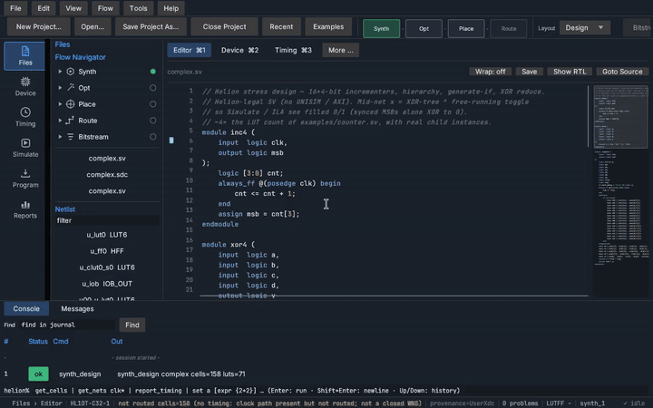
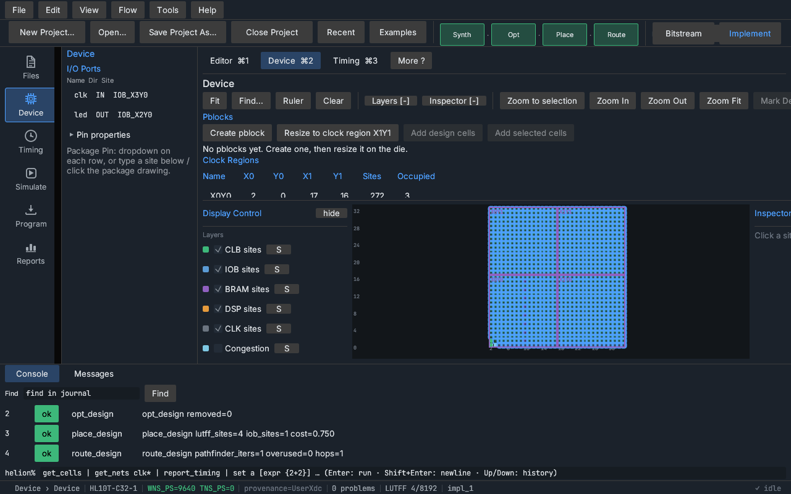
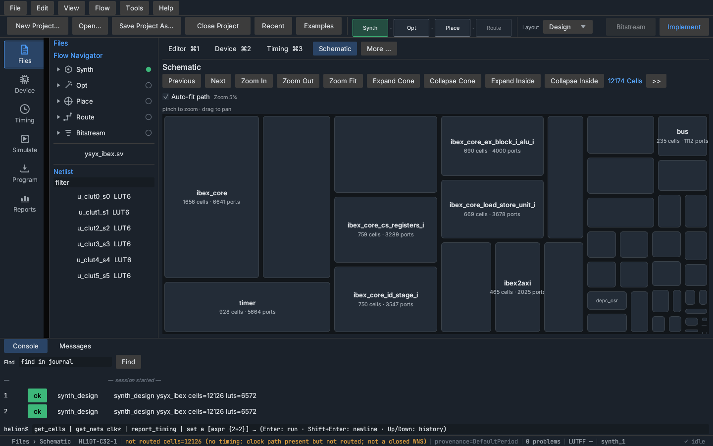
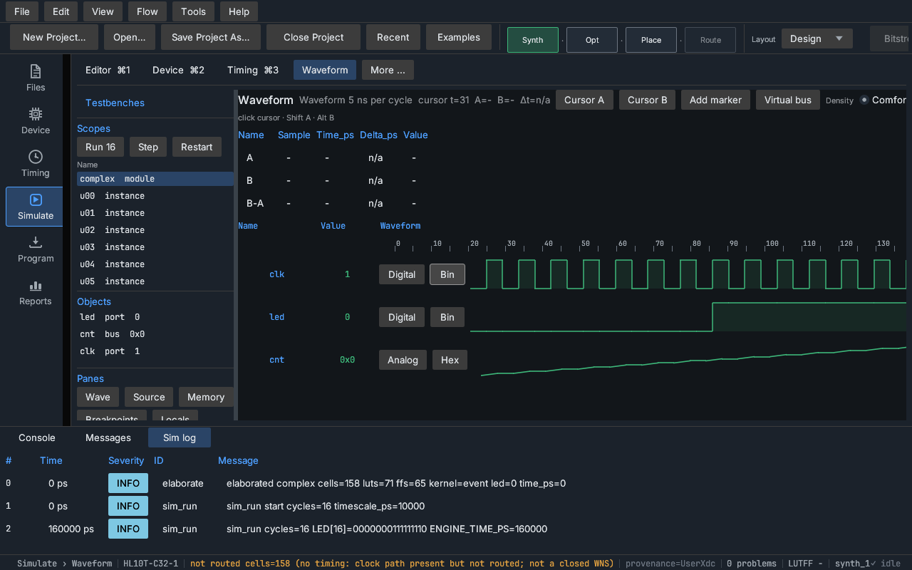
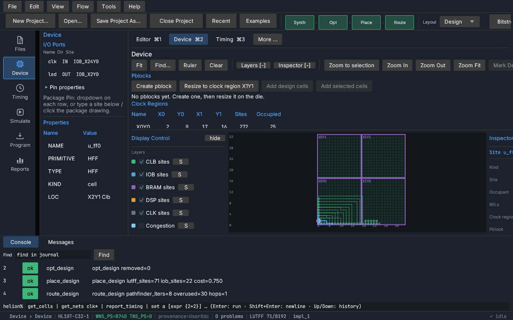
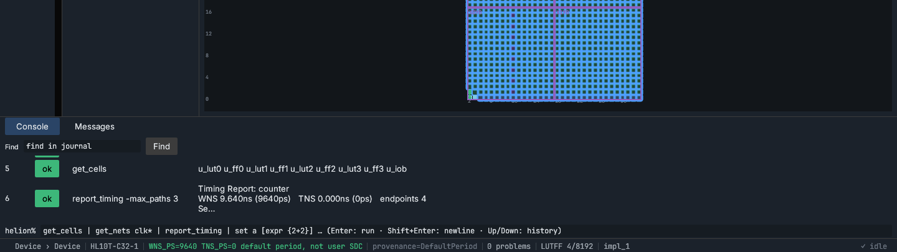
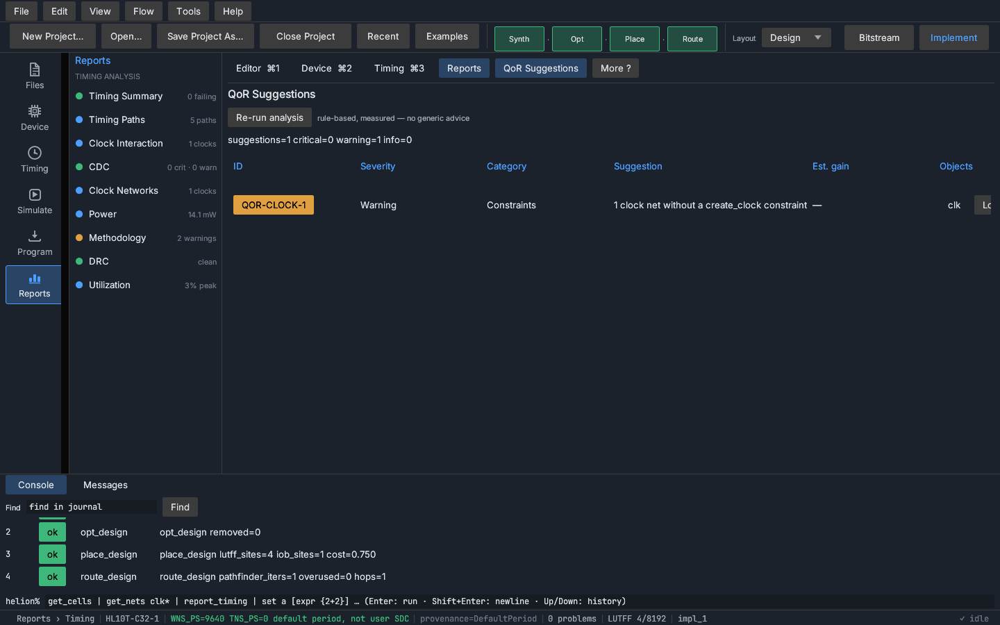
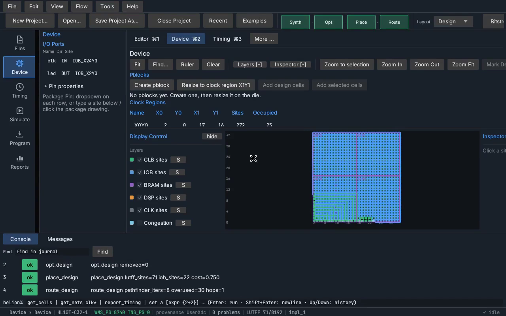

<p align="center">
  
</p>

<p align="center">
  <strong>The full FPGA flow in one Rust binary: synth, pack, place, route, timing, bitstream.</strong>
</p>

<p align="center">
  <a href="https://github.com/helion-fpga/helion/releases/latest">Download</a> &bull;
  <a href="https://helion-fpga.github.io/helion/">Docs</a> &bull;
  <a href="CHANGELOG.md">Changelog</a> &bull;
  <a href="ROADMAP.md">Roadmap</a> &bull;
  <a href="CONTRIBUTING.md">Contributing</a>
</p>

<p align="center">
  <a href="https://github.com/helion-fpga/helion/actions/workflows/ci.yml"></a>
  <a href="https://github.com/helion-fpga/helion/releases/latest"></a>
  <a href="https://github.com/helion-fpga/helion/releases"></a>
  <a href="LICENSE"></a>
</p>

<p align="center">
  <a href="docs/screenshots/demo-run.mp4"></a><br>
  <em>65-second tour: editor, synth to route, device view, schematic, timing reports, waveform. <a href="docs/screenshots/demo-run.mp4">Watch the full video</a>.</em>
</p>

Helion is an FPGA CAD suite: write SystemVerilog or VHDL, run one command, and get a placed, routed, timing-closed bitstream. No vendor tools, no black boxes. It targets its own HL10T die, Xilinx 7-series parts (xc7a35t today), iCE40 (HX8K), and ECP5 (LFE5U-85F), and it is architected for more: the compiler emits a vendor-neutral netlist IR, and each device family is a backend.

## Screenshots

All from real runs.

<p align="center">
  <br>
  <em>Physical View 2.0: complex.sv placed, 71 LUTFFs + 22 IOBs, journal showing the real opt/place/route run, WNS_PS=8740</em>
</p>

<p align="center">
  <br>
  <em>Schematic with level-of-detail blocks on a 12,174-cell Ibex</em>
</p>

<p align="center">
  <br>
  <em>Waveform viewer: real 16-cycle sim on complex.sv, LED trace toggling</em>
</p>

<p align="center">
  <br>
  <em>Cross-probing: cell u_ff0 selected, routes highlighted on the die, Inspector populated</em>
</p>

<p align="center">
  <br>
  <em>Real Tcl console: synth_design, place_design, write_bitstream, get_cells</em>
</p>

<p align="center">
  <br>
  <em>QoR suggestions engine with measured impact ranking</em>
</p>

## Why Helion

- **One binary, whole flow.** `helion implement design.prj` runs synthesis, packing, placement, PathFinder routing, STA, bitstream. No toolchain stitching.
- **Deterministic.** Same RTL in, same bits out. The QoR gate fails the build if LUT counts, WNS, or bitstream bytes move without a reason recorded in the same commit.
- **Fail-loud.** Over-capacity designs error instead of emitting a clipped bitstream; congested routing is refused, never silently clipped.
- **Measured.** Frontend allocations fell 24.2M to 409k (down 98%) across the perf campaign; the area campaign cut uart 420 to 244 LUTs (down 42%). Every number traces to the benchmark report or a pushed commit.
- **Multi-vendor by design.** `NetlistIR` plus a `Backend` trait. HL10T, Xilinx 7-series, iCE40, and ECP5 are the first four backends, not the only ones.

## Features

**Compile**
- SystemVerilog / VHDL-2008-subset frontend, AIG-based synthesis with ABC-style rewriting (structural hashing, cut-based resynthesis)
- LUT6/FF/DSP/BRAM packing, simulated-annealing placement, PathFinder routing
- Graph-based STA: WNS/TNS, hold checks, per-path reports
- Bitstream generation with hash-verified round trips

**Xilinx 7-series backend (v3.0)**
- xc7a35t device model from open bitstream databases (Project X-Ray)
- Pack, place, route, FASM emission, frames-to-bitstream, all in Rust, zero vendor tools
- FASM output byte-identical to prjxray's encoder; generated bitstreams decode through Project X-Ray tooling with zero unconverted bits and the correct IDCODE
- Hard blocks: CARRY4, RAMB18E1/RAMB36E1, DSP48E1, BUFG clocking, IO standards from X-Ray segbits; per-device timing model consumed by STA

**iCE40 backend**
- iCE40-HX8K from Project IceStorm device data; pack, place, A* route, `.asc` emission, all in Rust, zero vendor tools
- LUT6 to LUT4 Shannon decomposition, bit-exact against arachne-pnr
- SB_CARRY chains, SB_RAM40_4K INIT (bit-exact vs arachne-pnr), SB_PLL40 config (exact vs arachne-pnr), global clock network
- `.asc` output round-trips bit-perfect through icepack/iceunpack

**ECP5 backend**
- LFE5U-85F from the Project Trellis open bitstream database; pack, place, A* route, textcfg emission, all in Rust, zero vendor tools
- CCU2 carry chains (Xilinx MUXCY semantics preserved bit-for-bit), DP16KD block RAM with INIT, MULT18X18D DSP, PLL, DCC global clocks
- 24-bit counter blinky end to end: yosys to textcfg (852 arcs), accepted by `ecppack` with a valid ECP5 preamble

**Verification (v3.0)**
- SAT-based combinational equivalence checking (miter + Tseitin, FFs cut to pseudo-IOs)
- SystemVerilog assertions: immediate and concurrent assert, implication operators, `$rose`/`$fell`/`$stable`
- Clock-domain-crossing structural analysis (11 violation classes), integrated in the IDE

**IDE**
- Physical View 2.0: FPGA resource layers, solo/isolate, inspector, congestion and timing heat maps, find palette, ruler
- Schematic with level-of-detail for large designs, hierarchy browser, waveform viewer
- Cross-probing, Tcl console, design runs with strategy sweep, checkpoints, testbench runner, constraints wizard, QoR suggestions, VCD-driven power, integrated logic analyzer

## The full tour

<p align="center">
  <a href="docs/screenshots/demo-run.mp4"></a><br>
  <em>65 seconds, no audio: editor, implement flow, device view, schematic, timing reports, waveform sim on complex.sv. Click to watch.</em>
</p>

## Quickstart

```bash
git clone https://github.com/helion-fpga/helion.git
cd helion
cargo run -p helion-cli -- run examples/counter.sv --cycles 16
# LED[16]=0000000111111110, same bits in the fabric model and the event sim
```

Headless gold (the number that must not silently move):

```bash
cargo run -p helion-gui --bin helion-ide -- --headless examples/counter.sv
# must print WNS_PS=9640
```

## Installation

Prebuilt binaries are on the [releases page](https://github.com/helion-fpga/helion/releases/latest):

- Linux x86_64 (`.tar.gz`)
- macOS arm64 (`.zip` and `.tar.gz`)
- `SHA256SUMS.txt` for verification

macOS note: the app is ad-hoc signed, not notarized. On first launch, clear the quarantine flag once:

```bash
xattr -cr /Applications/Helion.app
```

## Building from source

Prerequisites: Rust 1.85 or newer (install via [rustup](https://rustup.rs)).

```bash
git clone https://github.com/helion-fpga/helion.git
cd helion
cargo build --release
# CLI:  ./target/release/helion
# IDE:  ./target/release/helion-ide
```

Run the test suite:

```bash
cargo test --workspace
```

## Benchmarks

10 real designs, identical RTL, Helion vs Yosys 0.69 + nextpnr-ecp5. Full report: [`docs/benchmarks/benchmark-report-2026-10-10.md`](docs/benchmarks/benchmark-report-2026-10-10.md).

| Design | Helion LUT6 | WNS (ps) | Helion wall | Yosys+nextpnr wall |
|---|---|---|---|---|
| PicoRV32 | 2477 | 8700 | 3.5 s | 10.4 s |
| AES-128 | 6534 | 8700 | 1.9 s | ~332 s |
| UART | 379 | 9600 | 0.3 s | 5.8 s |
| SPI | 62 | 9580 | 0.03 s | 3.6 s |

Caveat: Helion targets its own LUT6 fabric while the baseline targets Lattice LUT4, so absolute LUT counts are not silicon-to-silicon. Yosys+ABC produces 2 to 5x fewer LUTs (uart 420 to 244 LUTs so far). Helion's delay model is simpler and more optimistic than signoff STA; calibration is on the roadmap.

## Architecture

```
RTL -> helion-sv (synth) -> NetlistIR -> Backend trait
                                       |- HL10T: pack -> place -> route -> STA -> bitstream
                                       `- Xilinx 7-series: pack -> place -> route -> FASM -> frames -> .bit
```

The compiler never knows what a LUT is *for*. `NetlistIR` is vendor-neutral; each device family implements the `Backend` trait (pack, place, route, bitgen). Adding a device means writing a backend, not forking the compiler. Part facts live in HAD (`devices/helion/`), not hardcoded in the compiler.

**Legal fence:** Helion ships no proprietary vendor IP or databases. Vendor backends are built on open bitstream databases only.

## Roadmap

- Timing-model calibration, then timing-driven pack/place/route
- Interactive Tcl console (autocomplete, design-database introspection)

Done: backend hardening (trait driver, per-device timing models, 7-series hard blocks, big-design place and route proof), iCE40 backend on Project IceStorm, ECP5 backend on Project Trellis.

## Contributing

Rust, SystemVerilog, STA, IDE, or docs: [get involved](https://helion-fpga.github.io/helion/get-involved.html). See [CONTRIBUTING.md](CONTRIBUTING.md) and [good first issues](https://github.com/helion-fpga/helion/issues?q=is%3Aissue+is%3Aopen+label%3A%22good+first+issue%22).

## License

Licensed under [AGPL-3.0-or-later](LICENSE).

The "Helion" name and logo are trademarks of Saksham Srivastava; see
[TRADEMARKS.md](TRADEMARKS.md). The AGPL covers the code, not the brand:
if you fork or redistribute a modified version, rename it.

## Repository Traffic

<!-- TRAFFIC-START -->
| Metric | Total | Uniques | Days tracked |
|---|---|---|---|
| clones | 1560 | 594 | 14 |
| views | 17 | 12 | 14 |
<!-- TRAFFIC-END -->

Full history: [`traffic/`](traffic/) (updated daily; GitHub drops traffic data after 14 days).
