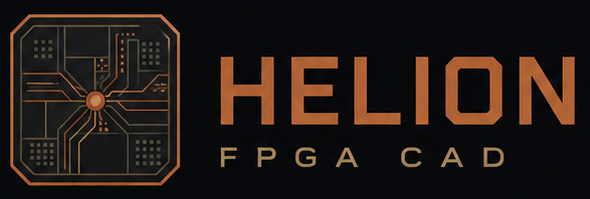
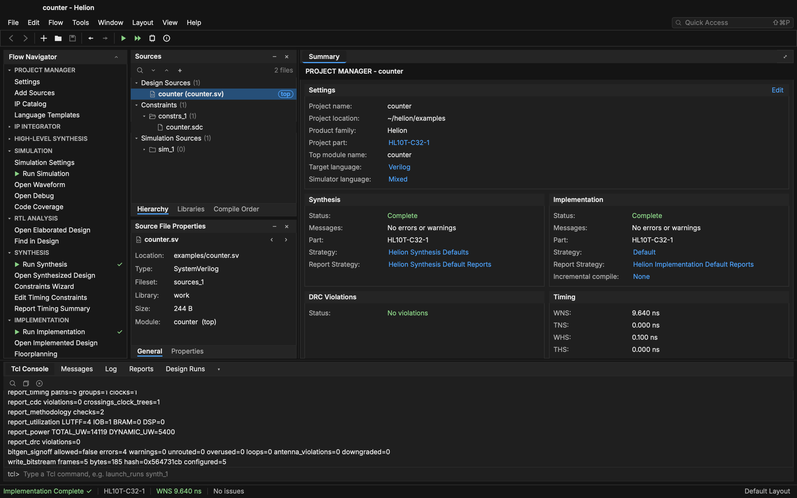
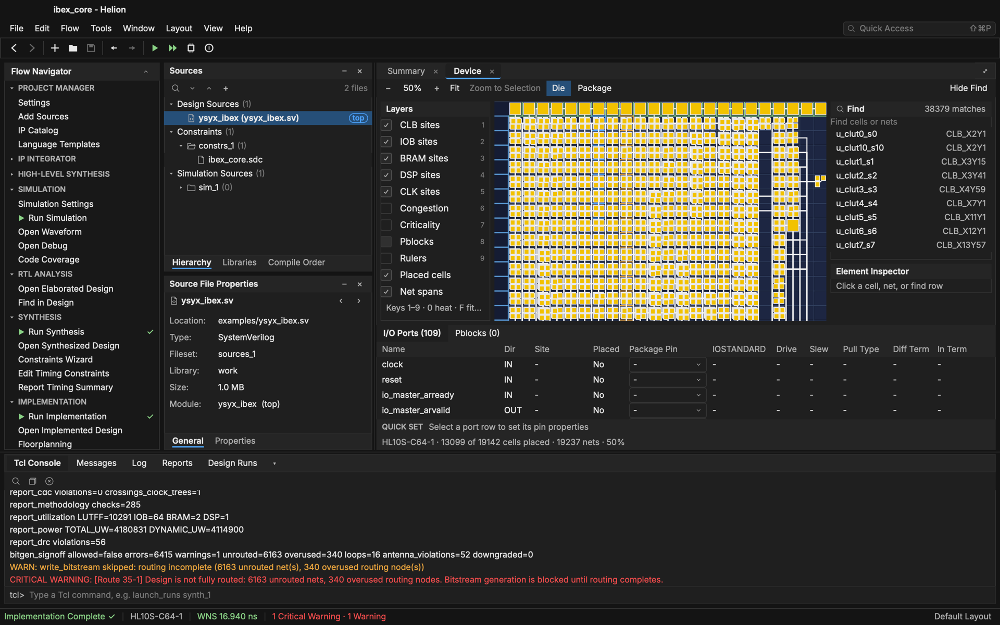
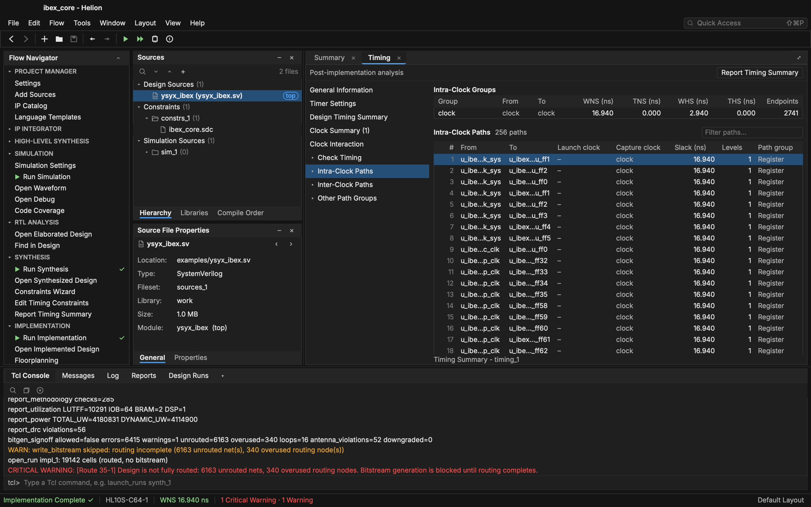
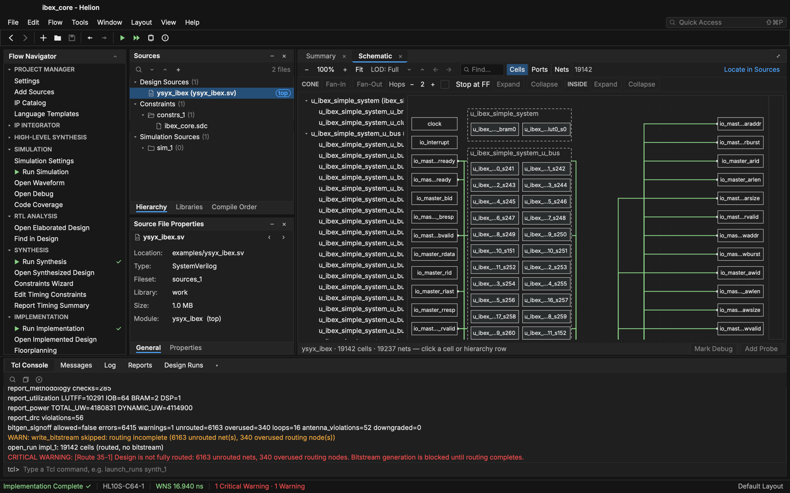
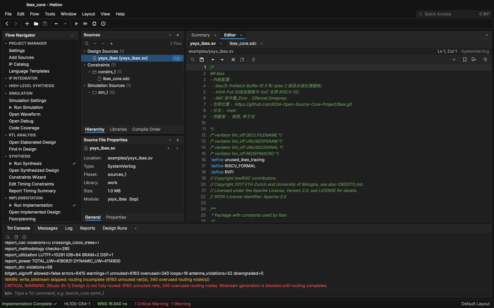
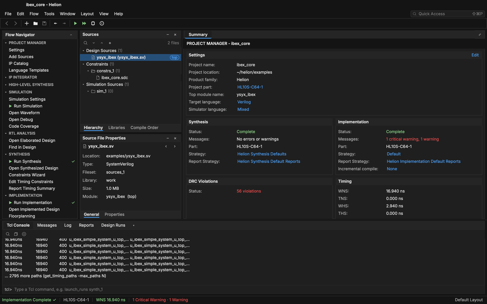

<p align="center">
  
</p>

<p align="center">
  <strong>An open-source FPGA design suite in Rust: synthesis, place and route, timing,<br>simulation, bitstreams and hardware debug, in one CLI and one IDE.</strong>
</p>

<p align="center">
  <a href="https://github.com/helion-fpga/helion/actions/workflows/ci.yml"></a>
  <a href="https://github.com/helion-fpga/helion/releases/latest"></a>
  <a href="https://github.com/helion-fpga/helion/releases"></a>
  <a href="rust-toolchain.toml"></a>
  <a href="LICENSE"></a>
</p>

<p align="center">
  <a href="https://helion-fpga.github.io/helion/">Website</a> &middot;
  <a href="https://helion-fpga.github.io/helion/start.html">Install</a> &middot;
  <a href="https://helion-fpga.github.io/helion/use.html">User guide</a> &middot;
  <a href="CHANGELOG.md">Changelog</a> &middot;
  <a href="ROADMAP.md">Roadmap</a> &middot;
  <a href="CONTRIBUTING.md">Contributing</a>
</p>

<p align="center">
  <br>
  <em>The Helion IDE after a full implementation of the ysyx Ibex RV32 core on an HL10S part.</em>
</p>

## What is Helion

Helion is a complete FPGA CAD flow written from scratch in Rust. You give it
SystemVerilog, VHDL or C; it synthesizes, packs, places, routes, runs static
timing analysis and writes a bitstream. The same engines drive a command-line
tool (`helion`), a Tcl console, and a desktop IDE (`helion-ide`) with the
views you expect from a commercial tool: Flow Navigator, device floorplan,
schematic, timing analysis, waveforms, reports and a Hardware Manager.

Helion has its own FPGA architecture, **HL10**, described in an open
architecture database (HAD), and backends for **Lattice iCE40**, **Lattice
ECP5** and **Xilinx 7-series** parts built on the open bitstream
documentation projects. No vendor tools, libraries or databases are needed.

- **Deterministic.** Same RTL in, same bits out. QoR tests fail when LUT
  counts, WNS or bitstream size regress, and CI checks the gold timing number
  on every push.
- **Self-contained.** One clone builds the CLI, the IDE and the device data.
  Nothing outside the repository and crates.io is needed.
- **Honest UI.** Every control in the IDE does real work, or is disabled and
  says why.

## Screenshots

All screenshots are of a real implementation of the full Ibex RV32 core, not mock-ups.

<table>
  <tr>
    <td width="50%"><br><sub><b>Device.</b> The routed design on the die, with nets drawn.</sub></td>
    <td width="50%"><br><sub><b>Timing.</b> Intra-clock paths from STA on the routed design.</sub></td>
  </tr>
  <tr>
    <td width="50%"><br><sub><b>Schematic.</b> The implemented netlist, with fan-in and fan-out cones.</sub></td>
    <td width="50%"><br><sub><b>Editor.</b> SystemVerilog source with highlighting and diagnostics.</sub></td>
  </tr>
  <tr>
    <td colspan="2"><br><sub><b>Tcl console.</b> <code>report_utilization</code> and <code>report_timing -max_paths 5</code> on the routed design.</sub></td>
  </tr>
</table>

## Features

**Design entry and synthesis**
- SystemVerilog (IEEE 1800 synthesizable subset) and VHDL-2008 subset frontends; C high-level synthesis
- AIG-based logic synthesis with ABC-style rewriting, LUT6 mapping, carry, DSP and block-RAM inference
- Out-of-context module synthesis with a checkpoint cache; IP packages (`.helion`), IP Catalog and block design

**Implementation**
- Packing, placement and PathFinder routing; pblock placement regions
- Design runs with strategies and seed sweeps, checkpoints (`.hckp`), incremental runs
- ECO edits with incremental bitstreams; partial reconfiguration (DFX) with per-module partial bitstreams
- Bitstream generation for every supported family

**Analysis**
- Graph-based STA: WNS/TNS, hold, per-path reports, clock interaction, XDC/SDC constraints
- Clock-domain-crossing analysis with eleven violation classes
- Utilization, vectorless and VCD-driven power, DRC and methodology checks, control sets, SSN, IBIS, QoR suggestions

**Simulation and verification**
- Event simulator and cycle-level fabric model; testbench runner with self-checking testbenches
- Waveform viewer with cursors, analog and fixed-point display, and SPI/UART/AXI-Lite/FSM decoders
- Code coverage, SystemVerilog assertions (subset), SAT-based equivalence checking (`helion equiv`)

**Hardware and debug**
- Hardware Manager with a simulated cable, openFPGALoader, and a native FTDI JTAG engine
- Integrated logic analyzer (ILA), VIO and JTAG-to-AXI over any JTAG cable
- Configuration memory: erase, blank check, program, verify, read back

**IDE**
- Vivado-style shell: Flow Navigator, Sources, Summary, command palette, dockable panes, light and dark themes
- Device view with I/O planning, package pins, pblocks and heat maps; schematic; timing; waveform; reports
- Tcl console on the same engines as the GUI, plus windowless modes for scripts and CI

The [user guide](https://helion-fpga.github.io/helion/use.html) walks through each one.

## Supported devices

| Family | Parts | Bitstream output | How it is checked |
|---|---|---|---|
| **Helion HL10** | `HL10T-C32-1` (8,192 LUT6), `HL10T-DSP1`, `HL10S-C64-1` (32,768 LUT6), `HL10M-C128-1` (131,072 LUT6) | `.hbits` | Gold QoR tests; bitstreams load into Helion's fabric model and simulator |
| **Lattice iCE40** | `ice40-hx8k` | IceStorm `.asc` (`icepack` makes the `.bin`) | `.asc` round-trips bit-exactly through icepack/iceunpack |
| **Lattice ECP5** | `LFE5U-85F` | Trellis text config (`ecppack` makes the `.bit`) | Blinky config accepted by `ecppack` |
| **Xilinx 7-series** | `xc7a35t` | FASM, frames and `.bit` | Blinky FASM-to-frames is byte-identical to prjxray; needs the Project X-Ray database on disk |

HL10 is Helion's own architecture. Its parts are defined in
[`devices/helion/`](devices/helion/); there is no HL10 silicon. Bitstreams for
the iCE40, ECP5 and 7-series backends have not yet been tested on boards.

**Hardware Manager.** The native JTAG engine drives FTDI MPSSE cables
(FT2232H, FT232H, including Digilent's on-board cables). Chain scans are
verified on a real ZedBoard (Zynq-7020 plus ARM DAP, 1 to 30 MHz).
Programming over the native cable is implemented but not yet verified on a
board. [openFPGALoader](https://github.com/trabucayre/openFPGALoader), when
installed, is used for program and flash; the simulated cable programs the
HL10 fabric model.

## Install

### Prebuilt binaries

Every tagged release on the
[releases page](https://github.com/helion-fpga/helion/releases/latest) has:

| File | Contents |
|---|---|
| `Helion-X.Y.Z-macos-arm64.zip` | `Helion.app` for Apple Silicon |
| `helion-X.Y.Z-aarch64-apple-darwin.tar.gz` | `helion`, `helion-ide`, `helion-prog`, device data, examples |
| `helion-X.Y.Z-x86_64-unknown-linux-gnu.tar.gz` | The same for Linux x86_64 |
| `SHA256SUMS.txt` | Checksums |

The Linux IDE needs `libxkbcommon0`, `libwayland-client0` and
`libusb-1.0-0`, which desktop distributions already have. The macOS app is
ad-hoc signed, not notarized; clear the quarantine flag once after
downloading:

```bash
xattr -cr /Applications/Helion.app
```

### From source

Prerequisites: [rustup](https://rustup.rs). The repository's
`rust-toolchain.toml` pins Rust 1.99.1 and rustup installs it on the first
build. Everything else comes with the clone: the Rune UI framework the IDE is
built on is vendored in `third_party/rune` (MIT), and `Cargo.lock` pins every
crates.io dependency.

On Linux, install the system libraries the IDE and the native JTAG driver
link against:

```bash
sudo apt-get install pkg-config libxkbcommon-dev libwayland-dev libusb-1.0-0-dev   # Debian/Ubuntu
sudo dnf install pkgconf libxkbcommon-devel wayland-devel libusb1-devel            # Fedora
```

```bash
git clone https://github.com/helion-fpga/helion.git
cd helion
cargo build --release --locked -p helion-cli -p helion-rune
# CLI:  ./target/release/helion
# IDE:  ./target/release/helion-ide   (--help lists the windowless modes)
```

On macOS, `./scripts/build-macos-app.sh` assembles `dist/Helion.app`.

## Quickstart

**Command line**

```bash
helion run examples/counter.sv --cycles 16
# LED[16]=0000000111111110  (same bits in the fabric model and the event simulator)

helion impl examples/counter.sv            # synth, pack, place, route, STA, bitstream
helion report_timing examples/counter.sv   # timing report
helion --help                              # every command
```

**IDE**

```bash
helion-ide                         # Start page with recent projects and bundled examples
helion-ide examples/counter.prj    # open a project
```

**Scripts and CI**, without a window, on the IDE's own Tcl interpreter:

```bash
helion-ide --headless examples/counter.sv   # full flow + report_timing; prints WNS_PS=9640
helion-ide --source flow.tcl                # Tcl batch, exit 1 on the first error
helion-ide --stdin                          # line-by-line Tcl console
helion-ide --doctor                         # target triple, device data, self-check
```

`WNS_PS=9640` on the empty-constraint `examples/counter.sv` is the project's
gold number: CI fails if it moves without a reason recorded in the same
commit.

## Benchmarks

Ten real designs, identical RTL, Helion 2.0.5 against Yosys 0.69 +
nextpnr-ecp5 (October 2026). Full method and results:
[`docs/benchmarks/benchmark-report-2026-10-10.md`](docs/benchmarks/benchmark-report-2026-10-10.md).

| Design | Helion LUT6 | Helion WNS (ps) | Helion wall | Yosys + nextpnr wall |
|---|---:|---:|---:|---:|
| PicoRV32 | 2,477 | 8,700 | 3.5 s | 10.4 s |
| AES-128 | 6,534 | 8,700 | 1.9 s | ~332 s |
| UART | 379 | 9,600 | 0.3 s | 5.8 s |
| SPI master | 62 | 9,580 | 0.03 s | 3.6 s |

Read these with care: Helion targeted its own LUT6 fabric and the baseline a
Lattice LUT4 part, so LUT counts are not like for like, and Yosys + ABC still
produces fewer LUTs. Helion's delay model is simpler and more optimistic than
nextpnr's; calibrating it is on the roadmap.

## Documentation

| | |
|---|---|
| [Getting started](https://helion-fpga.github.io/helion/start.html) | Install, build, first run |
| [User guide](https://helion-fpga.github.io/helion/use.html) | The IDE and the CLI, view by view |
| [Architecture](https://helion-fpga.github.io/helion/architecture.html) | Pipeline, crates, HAD parts, IR, constraints |
| [Tcl reference](docs/tcl-subset.md) | The Tcl language and commands the console supports |
| [Benchmarks](https://helion-fpga.github.io/helion/benchmarks.html) | Measured results and caveats |
| [Changelog](CHANGELOG.md) | What changed in each release |

## Project status and roadmap

The next release is **4.0**: the new Rune-based IDE replaces the egui IDE,
iCE40 and ECP5 backends join HL10 and Xilinx 7-series, the native JTAG
engine reaches real hardware, and the build is self-contained. See the [changelog](CHANGELOG.md) for the details.

Next up: verifying native programming on boards, timing-model calibration
against real silicon, wiring the October campaign's optimization passes into
the default flow, and the remaining IDE gaps listed in
[`crates/helion-rune/SWEEP.md`](crates/helion-rune/SWEEP.md). The
[roadmap](ROADMAP.md) has the full list.

## Contributing

Contributions are welcome: Rust, SystemVerilog, STA, the IDE, docs or
testing. Start with [CONTRIBUTING.md](CONTRIBUTING.md), the
[good first issues](https://github.com/helion-fpga/helion/issues?q=is%3Aissue+is%3Aopen+label%3A%22good+first+issue%22)
and [Discussions](https://github.com/helion-fpga/helion/discussions).
Please read the [Code of Conduct](CODE_OF_CONDUCT.md). Security issues go
through [SECURITY.md](SECURITY.md).

## License and trademarks

Helion is licensed under [AGPL-3.0-or-later](LICENSE).

"Helion" and the Helion logo are trademarks of Saksham Srivastava; see
[TRADEMARKS.md](TRADEMARKS.md). The license covers the code, not the brand:
if you distribute a modified version, give it a different name.

## Acknowledgements

- [Rune](https://github.com/anomalyco/rune) (MIT), the UI framework the IDE
  is built on, vendored in [`third_party/rune`](third_party/rune).
- [Project X-Ray](https://github.com/f4pga/prjxray),
  [Project IceStorm](https://github.com/YosysHQ/icestorm) and
  [Project Trellis](https://github.com/YosysHQ/prjtrellis), whose open
  bitstream documentation the vendor backends are built on.
- [sv-parser](https://github.com/dalance/sv-parser) and
  [varisat](https://github.com/jix/varisat), among the crates.io
  dependencies listed in `Cargo.lock`.
- The open-source cores used as examples and benchmarks, including
  [Ibex](https://github.com/lowRISC/ibex),
  [PicoRV32](https://github.com/YosysHQ/picorv32) and
  [SERV](https://github.com/olofk/serv), under their own licenses.

<details>
<summary>Repository traffic</summary>

<!-- TRAFFIC-START -->
| Metric | Total | Uniques | Days tracked |
|---|---|---|---|
| clones | 1560 | 594 | 14 |
| views | 17 | 12 | 14 |
<!-- TRAFFIC-END -->

Full history: [`traffic/`](traffic/), updated daily (GitHub keeps traffic data for 14 days).

</details>
