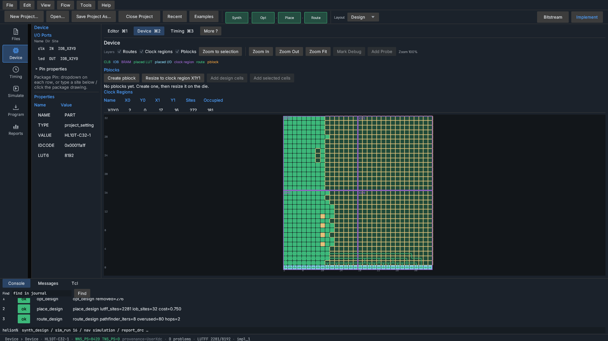
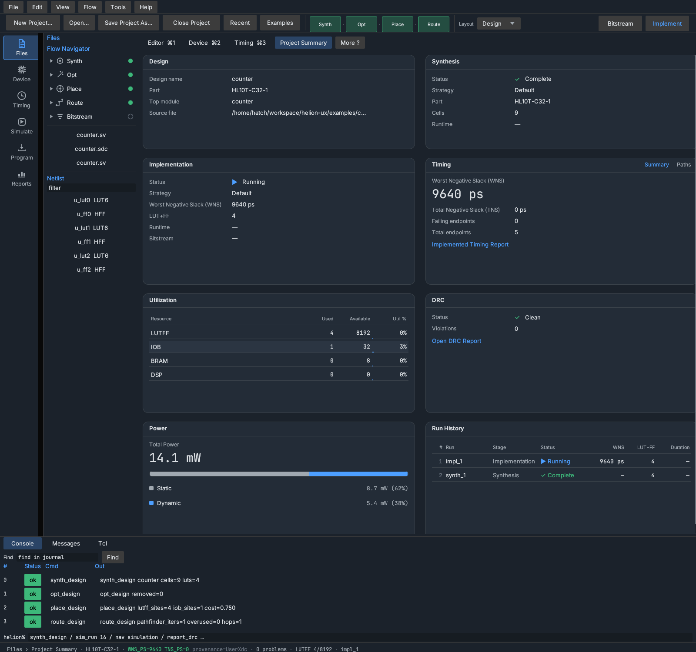
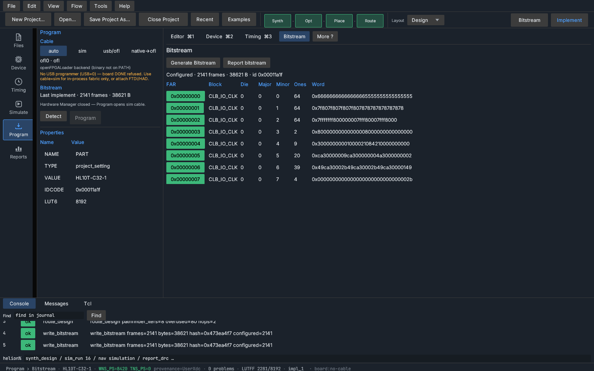

# Helion

**The full FPGA flow — synth, pack, place, route, timing, bitstream — in one Rust binary. Deterministic, fail-loud, and fast.**

[](https://github.com/helion-fpga/helion/actions/workflows/ci.yml)
[](https://github.com/helion-fpga/helion/releases/latest)
[](LICENSE-APACHE)



Helion is an FPGA CAD suite plus an original FPGA family. Write SystemVerilog or VHDL, run one command, and get a placed, routed, timing-closed bitstream — no vendor tools, no black boxes. It targets its own HL10T die today and is architected for more: the compiler emits a vendor-neutral netlist IR, and each device family is a backend.

[Download](https://github.com/helion-fpga/helion/releases/latest)
· [Docs](https://helion-fpga.github.io/helion/)
· [Changelog](CHANGELOG.md)
· [Roadmap](ROADMAP.md)
· [Contributing](CONTRIBUTING.md)

## Why Helion

- **One binary, whole flow.** `helion qor design.prj` runs synthesis → packing → placement → PathFinder routing → STA → bitstream. No toolchain stitching.
- **Deterministic.** Same RTL in, same bits out. The QoR gate fails the build if LUT counts, WNS, or bitstream bytes move without a reason recorded in the same commit.
- **Fail-loud.** Over-capacity designs error instead of emitting a clipped bitstream; congested routing is refused, never silently clipped.
- **Measured, not claimed.** Frontend allocations fell 12.7M → 409k (−97%) across the perf campaign; the area campaign cut uart 420 → 244 LUTs (−42%). Every number below traces to the benchmark report or a pushed commit.
- **Multi-vendor by design.** `NetlistIR` + a `Backend` trait. HL10T is the first backend, not the only one.

## Features



- SystemVerilog / VHDL-2008-subset frontend, AIG-based synthesis with ABC-style rewriting (structural hashing, cut-based resynthesis)
- LUT6/FF/DSP/BRAM packing, simulated-annealing placement, PathFinder routing
- Graph-based STA: WNS/TNS, hold checks, per-path reports
- Bitstream generation (`.hbits`) with hash-verified round trips
- Tcl session (`synth_design`, `place_design`, `write_bitstream`, `get_cells`, checkpoints)
- Fabric simulator + event sim — identical bits in RTL sim and the fabric model
- Desktop IDE: flow navigator, device view, schematic, waveform viewer, timing reports, command palette



## Architecture

```
RTL → helion-sv (synth) → NetlistIR → Backend (HL10T)
                                          ├─ pack → place → route → STA → bitstream
                                          └─ future: Xilinx 7-series, ECP5, …
```

The compiler never knows what a LUT is *for*. `NetlistIR` is vendor-neutral; each device family implements the `Backend` trait (pack, place, route, bitgen). Adding a device means writing a backend, not forking the compiler. Part facts live in HAD (`devices/helion/`), not hardcoded in the compiler.

**Legal fence:** Helion ships no proprietary vendor IP or databases. Vendor backends are built on open bitstream databases only.

## Quickstart

```bash
git clone https://github.com/helion-fpga/helion.git
cd helion
cargo run -p helion-cli -- run examples/counter.sv --cycles 16
# LED[16]=0000000111111110 — same bits in the fabric model and the event sim
```

Headless gold (the number that must not silently move):

```bash
cargo run -p helion-gui --bin helion-ide -- --headless examples/counter.sv
# must print WNS_PS=9640
```

Needs rustc **1.85**. CI is Linux; the desktop app is Apple Silicon (`aarch64-apple-darwin`).

## Benchmarks

10 real designs, identical RTL, Helion v2.0.5 vs Yosys 0.69 + nextpnr-ecp5. Full report: [`docs/benchmarks/benchmark-report-2026-10-10.md`](docs/benchmarks/benchmark-report-2026-10-10.md).

| Design | Helion LUT6 | WNS (ps) | Helion wall | Yosys+nextpnr wall |
|---|---|---|---|---|
| PicoRV32 | 2477 | 8700 | 3.5 s | 10.4 s |
| AES-128 | 6534 (80% of die) | 8700 | 1.9 s | ~332 s |
| UART | 379 | 9600 | 0.3 s | 5.8 s |
| SPI | 62 | 9580 | 0.03 s | 3.6 s |

All 10 designs completed every Helion stage (synth → pack → place → route → STA → bitstream). Read honestly: Helion targets its own LUT6 fabric while the baseline targets Lattice LUT4, so absolute LUT counts aren't silicon-to-silicon. Yosys+ABC still produces 2–5× fewer LUTs — the area gap is real and being closed (uart 420 → 244 LUTs so far). Helion's delay model is simpler and more optimistic than signoff STA; calibration is on the roadmap. Helion's SystemVerilog frontend parsed all 10 designs; Yosys 0.69's could not parse three of them (Ibex's assignment patterns, CORDIC's variable-bound loop, an inferred latch in MIPS). Ibex (~11.6k LUTs) exceeds the 8k-LUT die — the flow fails loudly instead of emitting a clipped bitstream.

Recent measured wins (all pushed, all green):

| Campaign | Result |
|---|---|
| Perf | Frontend allocations 12.7M → 409k (−97%); tokenizer −61%; frontend wall −69% |
| Area | uart 420 → 244 LUTs (−42%); PicoRV32 cross-cone sharing −10% |
| Correctness | Pack/place capacity checks + bitgen congestion refusal; 2 pre-existing functional bugs fixed |

## Roadmap

- Timing-model calibration, then timing-driven pack/place/route
- Xilinx 7-series backend via open bitstream databases
- ECP5 backend
- Interactive Tcl console (autocomplete, design-database introspection)
- ILA / on-chip logic analyzer
- Cross-probing: timing path → device view → schematic, all at once

## Contributing

Rust, SystemVerilog, STA, IDE, or docs — [get involved](https://helion-fpga.github.io/helion/get-involved.html). See [CONTRIBUTING.md](CONTRIBUTING.md) and [good first issues](https://github.com/helion-fpga/helion/issues?q=is%3Aissue+is%3Aopen+label%3A%22good+first+issue%22).

## License

Apache-2.0 OR MIT.
